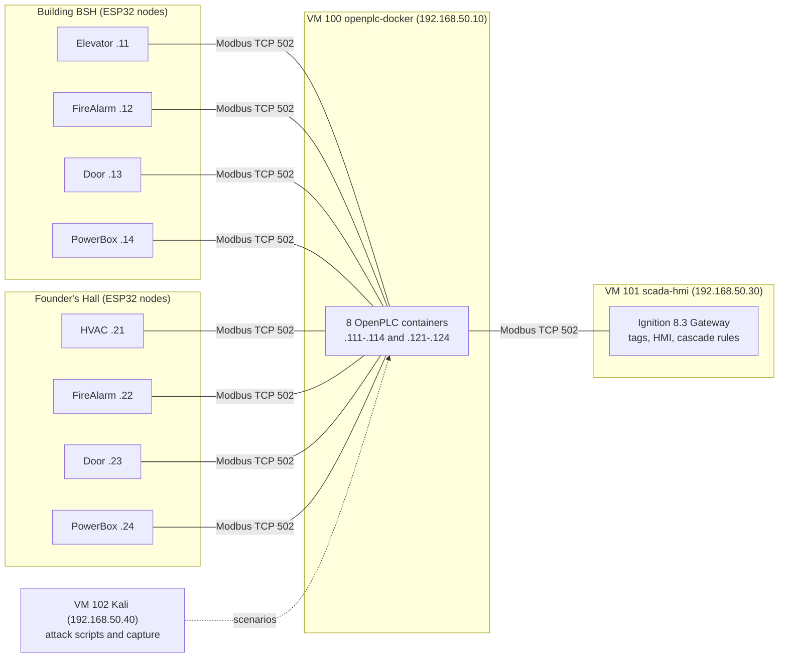

# CyberCity

A 3D-printed **smart-campus cyber-physical security testbed**: two model buildings, eight ESP32-controlled systems, a PLC layer, a SCADA/HMI, and a set of Modbus attack and defence scenarios. Built as a university capstone, **Aug 24 – Dec 11, 2026**.

> **Lab use only.** The attack scenarios in this repo target a private, isolated test network built for this project. Do not run them against systems you do not own or have written permission to test.

## What it is

Two buildings, **BSH** and **Founder's Hall (FH)**, with four subsystems each. Every subsystem is an ESP32 acting as a plain **Modbus TCP slave**. Each ESP32 is polled by **its own OpenPLC instance** running in a Docker container, and one **Ignition** SCADA gateway reads all eight PLCs and evaluates cross-system cascade rules (for example, a fire alarm taking the elevator out of service).

There are no protocol bridges anywhere: one ESP32 ⇄ one OpenPLC container ⇄ one Ignition gateway. Ignition never talks to an ESP32 directly.

## Architecture

All hosts sit on `192.168.50.0/24`. The Proxmox host `pve` is `192.168.50.143` and runs the three VMs above.

| Slot | BSH | FH |
|---|---|---|
| 1 | **Elevator** (3 floors, L293D motor, buttons, display) | **HVAC** zone unit (DHT11, relay, setpoint) |
| 2 | **Fire Alarm** (buzzer, RGB, pull station, flame, MQ-2 gas) | Fire Alarm, mirrored |
| 3 | **Door** (RC522 RFID, servo, IR, reed switch) | Door, mirrored |
| 4 | **Power Box** (relay, lights, fan) | Power Box, mirrored |

Founder's Hall is not a full mirror of BSH: it has an HVAC unit instead of an elevator.

### Node and address plan

| Node | ESP32 | OpenPLC container |
|---|---|---|
| BSH-Elevator | 192.168.50.11 | 192.168.50.111 |
| BSH-FireAlarm | 192.168.50.12 | 192.168.50.112 |
| BSH-Door | 192.168.50.13 | 192.168.50.113 |
| BSH-PowerBox | 192.168.50.14 | 192.168.50.114 |
| FH-HVAC | 192.168.50.21 | 192.168.50.121 |
| FH-FireAlarm | 192.168.50.22 | 192.168.50.122 |
| FH-Door | 192.168.50.23 | 192.168.50.123 |
| FH-PowerBox | 192.168.50.24 | 192.168.50.124 |

Each node exposes `HEARTBEAT` and `RECONNECT_COUNT` as its last two Input Registers, so a stalled node is visible from the SCADA.

## Status

As of **Oct 27, 2026** (the live version is [`STATUS.md`](STATUS.md)):

| Layer | State |
|---|---|
| ESP32 firmware | Done on all 8 nodes, bench-confirmed |
| OpenPLC programs | Done: all 8 built and running on their containers |
| Ignition SCADA | **Just started.** Gateway installed and licensed; first Modbus device connected. No real tags, screens or cascade rules yet |
| Attack scenarios | Designed, not yet run |

Target: **demo on Dec 11, 2026**.

## Tech stack

| Area | Tools |
|---|---|
| Field devices | ESP32 (Arduino core), `modbus-esp8266` library, Wokwi for simulation |
| PLC | OpenPLC Runtime v3 in Docker (macvlan, one container per node), OpenPLC Editor |
| SCADA / HMI | Ignition 8.3 (Perspective) |
| Infrastructure | Proxmox VE, Ubuntu VMs, Docker |
| Security | Kali Linux, Wireshark, Modbus attack scripts |
| Hardware | 3D-printed buildings; sensors, relays, servo and motor per system |

## Attack and defence scenarios

Defined in [`Piranga_Workflow_v2.md`](Piranga_Workflow_v2.md), Section 11:

1. Normal campus operation
2. Authorized door access
3. RFID UID clone and replay
4. False fire alarm injection (Modbus)
5. Elevator lockout (BSH)
7. Power Box manipulation
8. Cross-building cascade
9. Node isolation and resilience
10. Red/blue team exercise
11. HVAC sensor spoofing and setpoint tampering (FH)

Scenario 6 was dropped on Oct 5, 2026. Network captures go in [`Security_Capture/`](Security_Capture/) and attack scripts in [`Security_Capture/Kali/`](Security_Capture/Kali/).

## Repository layout

| Folder | Contents |
|---|---|
| [`docs/`](docs/) | **Project wiki** — reader-friendly pages: architecture, network plan, SCADA, security scenarios, rebuild guide, roadmap |
| [`Firmware/`](Firmware/) | ESP32 sketches, wiring, Wokwi simulations and bench-test notes, one folder per system; [`Firmware/WORKFLOW.md`](Firmware/WORKFLOW.md) is the build process |
| [`PLC_Logic/`](PLC_Logic/) | OpenPLC programs, ladder diagrams and Modbus register maps, one folder per system |
| [`SCADA_HMI/`](SCADA_HMI/) | Ignition tag maps, tag exports, screens and cascade rules |
| [`BSH_Systems/`](BSH_Systems/), [`FH_Systems/`](FH_Systems/) | Design document for each system |
| [`BSH_Sensors/`](BSH_Sensors/), [`FH_Sensors/`](FH_Sensors/) | Component reference sheets |
| [`Security_Capture/`](Security_Capture/) | Packet captures and attack scripts (Kali-side work in `Security_Capture/Kali/`) |
| [`Logs/`](Logs/) | One decision-and-lessons log per working day |
| [`References/`](References/) | Datasheets, guides and notes |
| `Archive/` | Retired designs, kept as history only |

New here? Read the [project wiki in `docs/`](docs/README.md). Start with [`00_START_HERE.md`](00_START_HERE.md), then [`STATUS.md`](STATUS.md). [`Piranga_Workflow_v2.md`](Piranga_Workflow_v2.md) is the master design document.

## Getting started

This is a hardware project, so there is nothing to `npm install`. To reproduce one node:

1. Read the system's design doc in `BSH_Systems/` or `FH_Systems/` and wire it per its `Firmware/<System>/` folder.
2. Copy the sketch from `Firmware/<System>/`, set your own Wi-Fi name and password in the sketch, and flash it with the Arduino IDE. Use plain ASCII only in `.ino` files.
3. Create the node's OpenPLC container and load `PLC_Logic/<System>/Program.st` (see [`PLC_Logic/README.md`](PLC_Logic/README.md)).
4. Read the node's registers from a Modbus client and confirm the heartbeat is rising.

Hardware notes that bite: GPIO 34–39 on the ESP32 are input-only with no internal pull resistors, and GPIO 0, 2, 5, 12 and 15 are strapping pins.

## Roadmap

1. ESP32 firmware, all nodes: **done**
2. OpenPLC layer, all nodes: **done**
3. SCADA tags and a shared device template: in progress
4. HMI screens and a campus map: planned
5. Cascade rules: planned
6. Attack scenarios and capture: planned
7. Demo, Dec 11, 2026

## Contributing

This is a solo capstone project, and issues and ideas are welcome. Work is done one system at a time. Every working session ends with an entry in [`Logs/`](Logs/).

## License

Released under the [MIT License](LICENSE).

The license covers the original material in this repository (firmware, PLC programs, scripts and documents written for this project). It does **not** cover third-party files kept under `References/` (vendor manuals, datasheets and books), which stay under their own copyright and terms.

## Author

**lfoliveira08**
