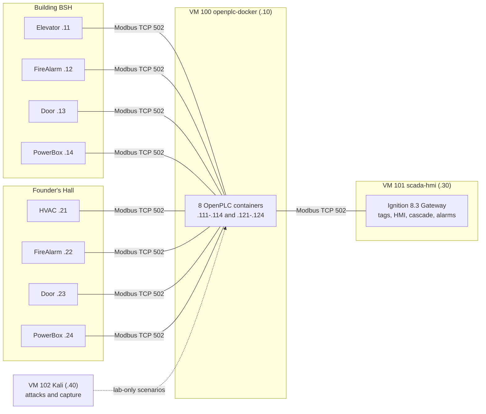
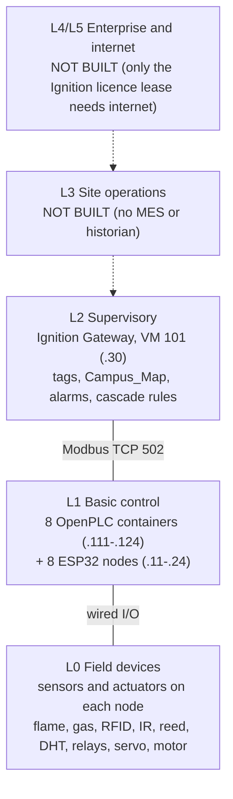

# Architecture

Source of truth: [`../CLAUDE.md`](../CLAUDE.md) §2 (hard facts) and [`../Piranga_Workflow_v2.md`](../Piranga_Workflow_v2.md). Node counts and addresses here are **verified** against `CLAUDE.md` §2.

## The idea

Two model buildings — **BSH** and **Founder's Hall (FH)** — with **four subsystems each**, so **eight ESP32 nodes** in total. Each ESP32 is a plain **Modbus TCP slave**, polled by **its own dedicated OpenPLC container**. One **Ignition** SCADA gateway reads all eight PLCs and evaluates cross-system cascade rules.

There are **no protocol bridges**: one ESP32 ⇄ one OpenPLC container ⇄ one Ignition gateway. Ignition never talks to an ESP32 directly.

## Data path

All hosts sit on `192.168.50.0/24`; the Proxmox host `pve` (`.143`) runs the three VMs. Full detail on the [Network & IP plan](Network-and-IP.md) page.

## Purdue Model mapping

CyberCity follows the **Purdue Model** (the layered reference model for industrial control systems). The design docs name it as the reason for the per-system layout: each system gets its own dedicated controller, with SCADA/HMI aggregating above them (`../Piranga_Workflow_v2.md` line 40, and the Sep 8, 2026 entry in its decisions log, line 423 — **verified**).

The level-by-level mapping below is **not written in any earlier doc**. It uses the standard level definitions and was **accepted by Luis in chat on Nov 12, 2026**.

| Purdue level | In CyberCity | State |
|---|---|---|
| **L0** Field devices | Sensors and actuators on each node | built, bench-confirmed (`../STATUS.md`) |
| **L1** Basic control | The 8 OpenPLC containers and the 8 ESP32 nodes (I/O plus local safe-state logic) | built; PLC programs running |
| **L2** Supervisory | Ignition: tags, the `Device` UDT, Campus_Map, alarms, cascade rules | built, partly tested (Luis-reported) |
| **L3** Site operations | none | not built |
| **L4/L5** Enterprise / internet | none | not built |

Kali (VM 102) sits **outside** the model as the attacker.

### Where the lab differs from a real Purdue deployment
- **The network is flat.** A real deployment separates the levels with firewalls and a DMZ. Here every node, container and VM shares `192.168.50.0/24` with no zones between levels. The Nov 10 recon capture confirmed this and also found personal devices on the same subnet (`../STATUS.md`, `../Security_Capture/Captures/`). The flat network is part of why the attack scenarios work, and it is worth stating in the report.
- **The Workflow's wording is looser.** It says "level 2–3: SCADA/HMI aggregation" (line 40). On the standard model SCADA/HMI is L2 and L3 is site operations, which the lab does not have. This page uses the standard definition.
- **Ignition is the only L2 component.** There is no historian, engineering workstation or L3 layer, so the model is shown only up to L2.

### How the attack scenarios line up (assumed, not documented before)
| Scenario | Level it targets |
|---|---|
| 4, 5, 7 (Modbus coil writes), 11 (spoofed input register / setpoint) | the **L1 ↔ L2** Modbus link and the L1 controllers |
| 3 (Modbus door-open injection) | the same L1 ↔ L2 link, on the Door node |
| 12 (PLC logic injection through the OpenPLC web UI on port 8080) | the **L1 engineering channel** |
| 13 (ESP32 bricking, spare board) | the **L0/L1 device** itself |
| 14 (combined MITM) | both the **L0/L1** and **L1/L2** links |

See [Security scenarios](Security-Scenarios.md) for the list itself.

## The systems

| Slot | BSH | FH |
|---|---|---|
| 1 | **Elevator** (3 floors, L293D motor, buttons, display) | **HVAC** zone unit (DHT, relay, setpoint) |
| 2 | **Fire Alarm** (buzzer, RGB, pull station, flame, gas) | Fire Alarm, mirrored |
| 3 | **Door** (RC522 RFID, servo, IR, reed switch) | Door, mirrored |
| 4 | **Power Box** (relays) | Power Box, mirrored |

**Founder's Hall is not a full mirror of BSH** — slot 1 is HVAC in FH, not an elevator. FH has no elevator and no perimeter system.

Every node exposes `HEARTBEAT` and `RECONNECT_COUNT` as its **last two Input Registers**, so a stalled node is visible from the PLC and SCADA.

> **Note (reported):** both PowerBox nodes were redesigned on Oct 28, 2026 from "lights + fan" to **power rails** that switch power to the other systems in their building. See `../STATUS.md` and `../Prototype_PowerRails/`. This is the current design per `STATUS.md`; the slot and IPs are unchanged.
