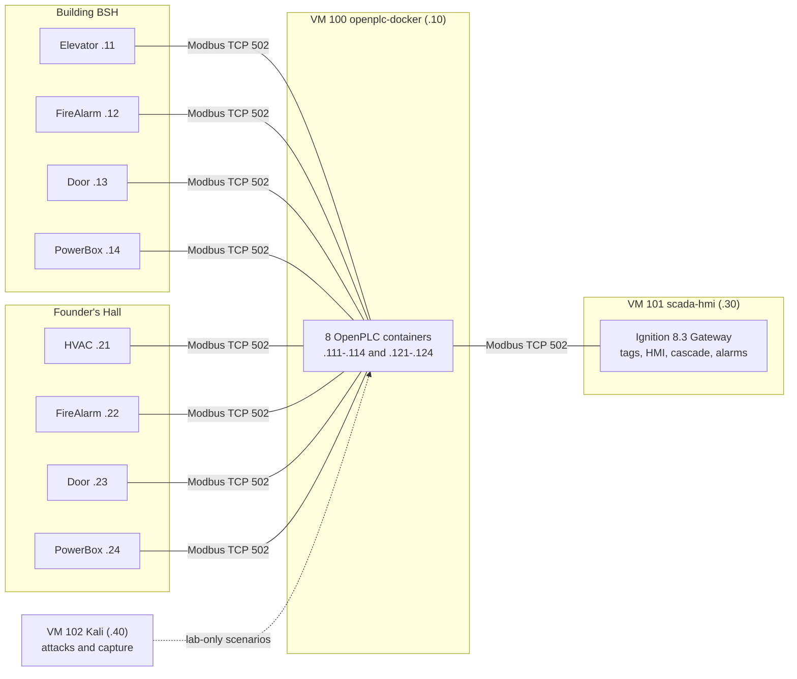

# Architecture

Source of truth: [`../CLAUDE.md`](../CLAUDE.md) §2 (hard facts) and [`../Piranga_Workflow_v2.md`](../Piranga_Workflow_v2.md). Node counts and addresses here are **verified** against `CLAUDE.md` §2.

## The idea

Two model buildings — **BSH** and **Founder's Hall (FH)** — with **four subsystems each**, so **eight ESP32 nodes** in total. Each ESP32 is a plain **Modbus TCP slave**, polled by **its own dedicated OpenPLC container**. One **Ignition** SCADA gateway reads all eight PLCs and evaluates cross-system cascade rules.

There are **no protocol bridges**: one ESP32 ⇄ one OpenPLC container ⇄ one Ignition gateway. Ignition never talks to an ESP32 directly.

## Data path

All hosts sit on `192.168.50.0/24`; the Proxmox host `pve` (`.143`) runs the three VMs. Full detail on the [Network & IP plan](Network-and-IP.md) page.

## The systems

| Slot | BSH | FH |
|---|---|---|
| 1 | **Elevator** (3 floors, L293D motor, buttons, display) | **HVAC** zone unit (DHT, relay, setpoint) |
| 2 | **Fire Alarm** (buzzer, RGB, pull station, flame, gas) | Fire Alarm, mirrored |
| 3 | **Door** (RC522 RFID, servo, IR, reed switch) | Door, mirrored |
| 4 | **Power Box** (relays) | Power Box, mirrored |

**Founder's Hall is not a full mirror of BSH** — slot 1 is HVAC in FH, not an elevator. FH has no elevator and no perimeter system.

Every node exposes `HEARTBEAT` and `RECONNECT_COUNT` as its **last two Input Registers**, so a stalled node is visible from the PLC and SCADA.

> **Note (reported):** both PowerBox nodes were redesigned on Oct 28, 2026 from "lights + fan" to **power rails** that switch power to the other systems in their building. See `../STATUS.md` and `../Prototype_PowerRails/`. This is the current design per `STATUS.md`; the slot and IPs are unchanged.
